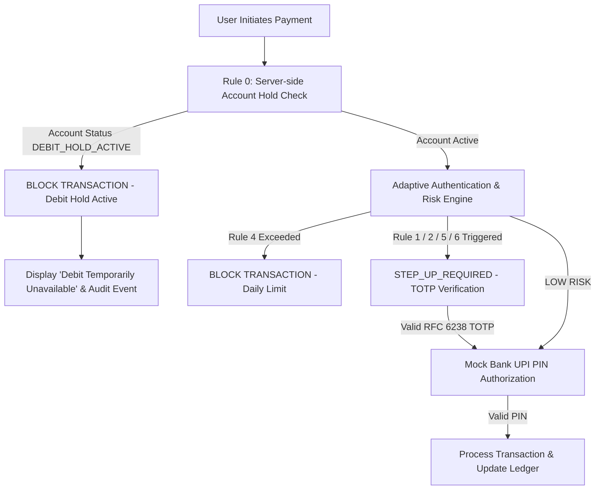
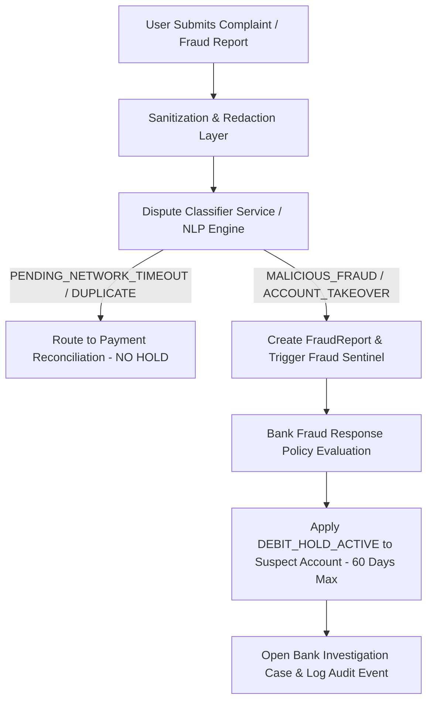

# SecureUPI — Adaptive MFA, Account Freeze & AI/NLP Smart Dispute Prototype

> **PROTOTYPE DISCLAIMER & NOTICE**  
> *This project is an educational and academic prototype demonstrating application-layer adaptive authentication, simulated bank-side temporary debit holds, and NLP dispute classification. It does NOT connect to NPCI, PSPs, real banks, or production payment networks. All account holds, UPI PIN authorizations, and bank workflows shown are simulated for research and educational purposes.*

---

## 📌 Core Research Architecture

SecureUPI combines three advanced security & support modules into a unified UPI application architecture:

1. **Adaptive Multi-Factor Authentication (MFA) Engine**: Dynamically evaluates risk before delegating payment authorization to the simulated bank UPI PIN terminal.
2. **Prototype Account Freeze / Temporary Debit Hold**: Simulates bank-side fraud-response protocol by placing reported suspect accounts into `DEBIT_HOLD_ACTIVE` status (configurable policy duration default: **60 DAYS**).
3. **AI/NLP Smart Dispute Categorizer**: Classifies unstructured user complaints using deterministic pattern matching & LLM-extensible NLP routing.

---

## 🏗️ System Architecture & Workflow





---

## 🔒 Configurable Risk & Security Rules

| Rule ID | Parameter | Default | Engine Behavior |
| :--- | :--- | :--- | :--- |
| **RULE 0** | Account Debit Hold Check | `Active` | Immediate server-side block if account is `DEBIT_HOLD_ACTIVE` |
| **RULE 1** | Verification Threshold | `₹15,000` | Trigger `STEP_UP_REQUIRED` if amount > threshold |
| **RULE 2** | New Payee Verification | `Enabled` | Trigger `STEP_UP_REQUIRED` for first-time payees |
| **RULE 3** | Trusted Payees Bypass | `Allowed` | Trusted payees bypass new-payee rule (high value rules apply) |
| **RULE 4** | Daily Cumulative Limit | `₹50,000/day` | Hard block `BLOCK_TRANSACTION` if daily total + amount > limit |
| **RULE 5** | Per-Payee Limit | Custom | Trigger `STEP_UP_REQUIRED` if amount > payee custom limit |
| **RULE 6** | Untrusted Device Session | `Enabled` | Trigger `STEP_UP_REQUIRED` if session device ID is untrusted |
| **POLICY 1** | Max Temporary Debit Hold Period | `60 Days` | Configurable policy threshold for debit hold expiration |

---

## 🛠️ Quick Start & Setup

### 1. Install Dependencies
```bash
npm install
```

### 2. Configure Environment & Database
```bash
# Push schema and seed demo accounts
npx prisma db push
npx tsx prisma/seed.ts
```

### 3. Run Security & Integration Test Suite
```bash
npm run test
```

### 4. Build & Start Development Server
```bash
npm run dev
```
Open [http://localhost:3000](http://localhost:3000) in your browser.

---

## 🔑 Preloaded Demo Credentials

| Role | Email | Password | Purpose / Privileges |
| :--- | :--- | :--- | :--- |
| **Standard User** | `demo@secureupi` | `password123` | Balance ₹75,000, linked HDFC Bank account (`•••• 4821`), UPI PIN `123456` |
| **Bank Operator** | `operator@secureupi` | `password123` | Access to **Bank Operations Console** (`/bank-ops`), hold release authorization |
| **Suspect Account** | `suspect@secureupi` | `password123` | UPI ID `suspect@upi`, pre-seeded in `DEBIT_HOLD_ACTIVE` status |

---

## 🧪 Demonstration Scenarios

1. **Scenario 1 — Normal Payment Dispute**:
   - Navigate to **Support → Smart Dispute** (`/support/smart-dispute`).
   - Enter: *"I tried to pay the shopkeeper but the app crashed and my money is gone but he didn't get it."*
   - **Result**: Categorized as `PENDING_NETWORK_TIMEOUT` (Confidence 94%), routed to `PAYMENT_STATUS_RECONCILIATION`. **No merchant account freeze occurs**.

2. **Scenario 2 — Unauthorized Payment**:
   - Enter: *"I don't recognize this transaction. I never made this payment."*
   - **Result**: Categorized as `UNAUTHORIZED_TRANSACTION`, routed to `UNAUTHORIZED_TRANSACTION_INVESTIGATION`, flagged for human review.

3. **Scenario 3 — Duplicate Charge**:
   - Enter: *"I was charged twice for the same payment."*
   - **Result**: Categorized as `DUPLICATE_TRANSACTION`, routed to `DUPLICATE_PAYMENT_REVIEW`.

4. **Scenario 4 — Fraud Report & Debit Hold Activation**:
   - Navigate to **Support → Fraud Reports** (`/support/fraud-reports`).
   - Submit report against payee `suspect@upi` with category `MALICIOUS_FRAUD`.
   - **Result**: Fraud response policy triggers automatic `DEBIT_HOLD_ACTIVE` status on `suspect@upi` for **60 DAYS**. `DEBIT_HOLD_ACTIVATED` audit event logged.

5. **Scenario 5 — Frozen Account Payment Rejection**:
   - Log in as suspect (`suspect@secureupi` / `password123`).
   - Attempt any payment (e.g. ₹500 to `rahul@upi`).
   - **Result**: Server-side rejection with error *"Debit temporarily unavailable while your bank investigates a security report."* Audit log `DEBIT_ATTEMPT_BLOCKED`.

6. **Scenario 6 — Hold Expiration**:
   - Execute `/api/cron/expire-holds`. Holds past `expiresAt` automatically transition to `EXPIRED` status, restoring account status to `ACTIVE`.

7. **Scenario 7 — Manual Hold Release by Bank Operator**:
   - Log in as Bank Operator (`operator@secureupi` / `password123`) and navigate to **Bank Operations** (`/bank-ops`).
   - Select active hold, enter release reason, and click **Release Hold**.
   - **Result**: Account restored to `ACTIVE`, audit log `DEBIT_HOLD_RELEASED`.

---

## 📜 License & Citation

Designed for academic research and educational demonstration of application-layer adaptive authentication and bank fraud response simulation.
